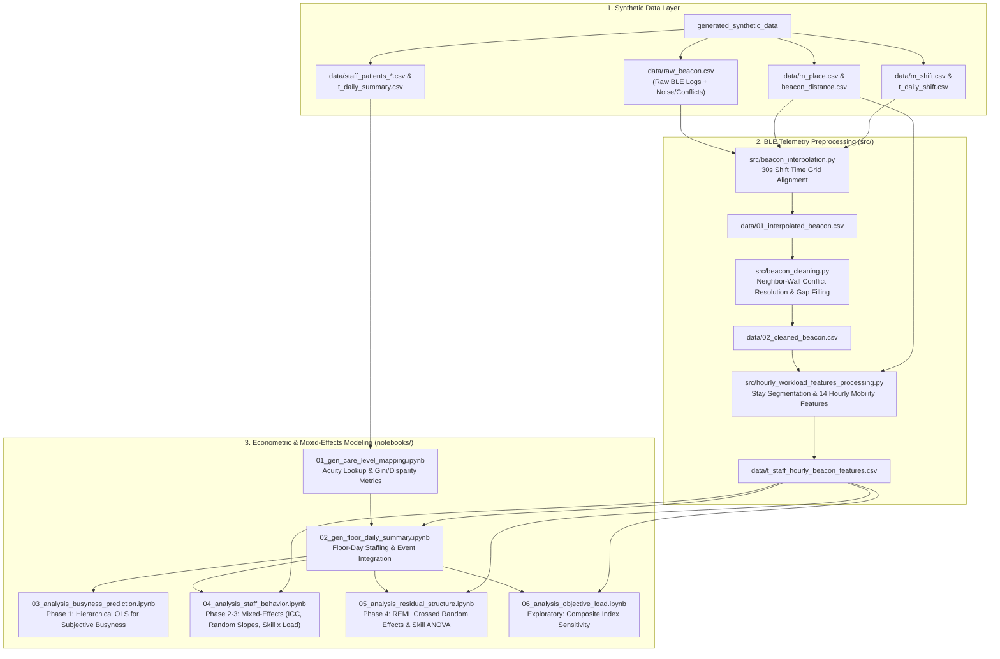

# Clinical Workflow & Indoor BLE Telemetry Modeling Pipeline

> [!IMPORTANT]
> **Confidentiality & Data Sanitization Disclaimer**: This repository is a sanitized, public-ready portfolio version of a clinical operations and indoor positioning research project. All proprietary hospital data, staff identifiers, facility floor layouts, and empirical outputs have been completely removed and replaced with a synthetic-generated dataset that preserves the exact relational schemas to run the pipeline end-to-end.

---

## 1. Project Overview & Problem Statement

In inpatient clinical settings, nursing workload is frequently assessed using either coarse administrative ratios (e.g., patient-to-nurse counts, acuity scores) or subjective shift ratings by ward managers. However, neither metric directly captures how clinical demand translates into real-time physical workflow—such as patient room visits, nurse station coordination, and spatial movement across the ward.

This project provides an end-to-end **BLE (Bluetooth Low Energy) Indoor Positioning & Econometric Modeling Pipeline** that:
1. **Reconstructs High-Resolution Trajectories**: Transforms noisy, irregular raw BLE beacon logs into regularized 30-second shift time grids (`src/beacon_interpolation.py`), resolves multi-receiver timestamp collisions using temporal neighbor walls and RSSI tie-breaking (`src/beacon_cleaning.py`), and extracts 14 hourly clinical mobility and stay features (`src/hourly_workload_features_processing.py`).
2. **Decomposes Subjective vs. Objective Workload**: Evaluates the extent to which manager-rated floor busyness (`1–5`), patient care acuity, workload inequality (Gini coefficient, standard deviation), and ward events (admissions, surgeries, procedures) explain observed staff workflow.
3. **Quantifies Staff & Skill-Tier Heterogeneity**: Uses Hierarchical OLS, Random-Intercept and Random-Slope Mixed-Effects models, and REML Crossed Random-Effects variance decomposition (`resid ~ (1|floor) + (1|floor_day) + (1|staff)`) to isolate individual and skill-tier (`Novice`, `Mid`, `Veteran`) workflow patterns after controlling for patient acuity and ward demand.

---

## 2. Architecture & Data Pipeline



---

## 3. Key Technical Highlights & Methodology

### A. Indoor BLE Signal Processing (`src/`)
- **Shift-Aware Time Grid Alignment (`src/beacon_interpolation.py`)**: Matches raw asynchronous BLE pings against scheduled shift windows (supporting overnight shift wrapping and configurable buffer windows) via `pandas.merge_asof` and vectorizes 30-second slot generation per `(user_id, shift_date, shift_id)`.
- **Neighbor-Wall Conflict Resolution (`src/beacon_cleaning.py`)**: When multiple receivers log a staff member within the same 30-second window, the cleaner inspects single-place neighbor "walls" within `--wall-max-minutes` (default 5 min) before falling back to strongest RSSI signal strength. Short unknown dropouts ($\le 1$ slot) bounded by identical normalized locations (grouping co-located nurse station beacons) are interpolated.
- **Stay Segmentation & Feature Engineering (`src/hourly_workload_features_processing.py`)**: Groups contiguous slot runs into stays, filters transient pass-by noise ($< 1$ min), splits stays across hour boundaries, and computes 14 hourly metrics including:
  - Category durations: `f_total_time_patient_rooms`, `f_total_time_nurse_station_areas`, `f_total_time_hallway`, `f_total_time_other_areas`
  - Spatial kinematics: `f_travel_distance`, `f_average_speed`, `f_num_location_changes`, `f_num_floor_changes`, `f_transition_entropy` (normalized Shannon entropy of place-to-place transitions)
  - Clinical visit structure: `f_num_patient_room_visits`, `f_num_unique_patient_room_visits`, `f_num_patient_room_long_visits` ($\ge 10$ min), and `f_num_patient_room_revisits` (returning within 30 min)

### B. Multi-Level Statistical Modeling (`notebooks/`)
- **Workload Inequality Metrics (`01_gen_care_level_mapping.ipynb`)**: Computes floor-day Gini coefficients, max-to-mean load ratios, and per-staff standard deviations from patient acuity assignments.
- **Hierarchical Block Regression (`03` & `04`)**: Evaluates incremental explanatory power ($\Delta \text{Adjusted } R^2$) across nested feature blocks: individual care load ($M_1$), ward clinical events ($M_2$), and subjective floor busyness ($M_3$).
- **Mixed-Effects & Random Slopes (`04_analysis_staff_behavior.ipynb`)**: Estimates Intraclass Correlation Coefficients ($\text{ICC} = \sigma^2_{\text{staff}} / (\sigma^2_{\text{staff}} + \sigma^2_{\varepsilon})$) and tests heterogeneous workload-to-workflow conversion via Skill $\times$ Care Load interaction F-tests and Likelihood Ratio Tests ($\text{LRT}, df=2$) on Random-Slope Linear Mixed Models.
- **REML Crossed Variance Decomposition (`05_analysis_residual_structure.ipynb`)**: Because days and staff are crossed within clinical floors, residual behavioral variation is partitioned using Restricted Maximum Likelihood (REML) variance components (`resid ~ 1 + (1|floor) + (1|floor_day) + (1|staff)`), followed by Crossed Random-Effects Wald tests across `Novice`, `Mid`, and `Veteran` tiers.

---

## 4. Redacted Proprietary Algorithms & Simplified Stub Logic

To protect intellectual property and custom clinical domain heuristics while keeping the repository 100% runnable end-to-end, specific inner algorithms and scoring formulas have been replaced with `# --- [REDACTED: PROPRIETARY LOGIC] ---` blocks and simplified baseline calculations that preserve exact function signatures, type hints, docstrings, and output schemas:

| Module / Notebook | Redacted Function / Block | Simplified Stub Replacement |
| :--- | :--- | :--- |
| `src/beacon_interpolation.py` | `BeaconInterpolator.assign_shifts` | Replaced 3-tier bidirectional buffer competition heuristic with a single-pass backward `merge_asof` interval check and calendar-date fallback. |
| `src/beacon_cleaning.py` | `BeaconCleaner.resolve_multiple_location_conflicts`<br/>`BeaconCleaner.interpolate_unknowns`<br/>`BeaconCleaner.normalized_place` | Replaced temporal neighbor-wall priority scoring and virtual zone boundary-matching interpolation with a basic RSSI tie-breaker and bounded forward-fill (`ffill`). |
| `src/hourly_workload_features_processing.py` | `Preparer.filter_short_shifts`<br/>`StayBuilder.build`<br/>`FeatureCalculator.movement_features`<br/>`FeatureCalculator.entropy`<br/>`FeatureCalculator.patient_room_features` | Replaced 3-hour shift filtering, 3-stage pass-by noise segmentation + cumulative-hole re-merging, active-transition speed, normalized Shannon entropy, and clinical revisit decay windows with single-pass contiguous grouping and simple baseline ratios. |
| `notebooks/01_gen_care_level_mapping.ipynb` | `lookup_care` & `gini` | Replaced modal acuity imputation and Lorenz-curve Gini inequality formula with first-value lookup and a clipped dispersion ratio (`std / mean`). |
| `notebooks/02_gen_floor_daily_summary.ipynb` & `config.yaml` | `LADDER_MAP` & hourly overlap skill-weighting | Replaced non-linear clinical competency tier weights and fractional shift-boundary overlap broadcasting with uniform unit weights (`1.0`). |
| `notebooks/03` – `05` | Hierarchical block selection, `Skill x Care Load` interaction, & REML 3-way crossed variance components | Replaced custom small-sample covariate curation, interaction F-tests, and crossed REML variance decomposition with baseline main-effects regressions and sample group-variance summaries. |
| `notebooks/06_analysis_objective_load.ipynb` & `generate_synthetic_data.py` | `compute_composite_index` & synthetic structural equations | Replaced proprietary composite workload weights (`0.35 / 0.40 / 0.25`) and empirical skill-tier slope priors with equal-weighted averages (`1/3`) and uniform/normal random baseline draws. |

---

## 5. Repository Structure

```text
public-portfolio-showcase/
├── .env.example                                  # Environment variable template
├── .gitignore                                    # Clean ignore rules for data/ and artifacts
├── README.md                                     # Project documentation & architecture guide
├── config.yaml                                   # Central configuration (paths, thresholds, mappings)
├── requirements.txt                              # Python dependencies
├── generate_synthetic_data.py                    # End-to-end synthetic dataset generator
├── src/
│   ├── __init__.py
│   ├── config_loader.py                          # Dynamic config.yaml + .env loader
│   ├── beacon_interpolation.py                   # Step 1: Raw BLE logs -> 30s shift grid
│   ├── beacon_cleaning.py                        # Step 2: Conflict resolution & gap interpolation
│   └── hourly_workload_features_processing.py    # Step 3: Stay segmentation & hourly features
├── notebooks/
│   ├── 01_gen_care_level_mapping.ipynb           # Acuity mapping & floor Gini/disparity summary
│   ├── 02_gen_floor_daily_summary.ipynb          # Floor-day staffing & clinical event merge
│   ├── 03_analysis_busyness_prediction.ipynb     # Phase 1: Subjective busyness hierarchical OLS
│   ├── 04_analysis_staff_behavior.ipynb          # Phase 2 & 3: Staff workflow OLS & Mixed-Effects
│   ├── 05_analysis_residual_structure.ipynb      # Phase 4: REML variance components & Skill ANOVA
│   └── 06_analysis_objective_load.ipynb          # Exploratory: Composite index sensitivity
└── data/
    └── .gitkeep                                  # Target directory for generated synthetic CSVs
```
